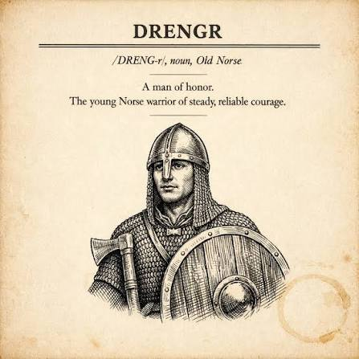
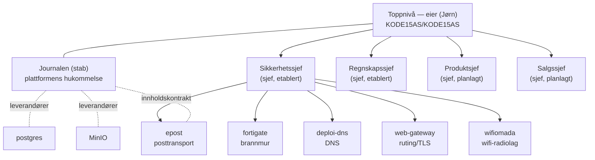

  

# KODE15 — en AI-first bedrift, bygget som kode

Dette er historien om hvordan et lite norsk selskap drifter hele sin
infrastruktur — brannmur, DNS, nettsider, tilgangskontroll — med
AI-agenter som gjør jobben og ett menneske som godkjenner den.

Vi kaller hver tjeneste en **drengr** — norrønt for den unge krigeren med
stø, pålitelig tapperhet. Hos oss er en drengr tre ting som alltid hører
sammen:

1. **Ett repo** — all konfigurasjon og kode, versjonert, ingenting utenfor.
2. **Én container** — tjenesten slik den faktisk kjører, bygget fra repoet.
3. **Én AI-agent** — som bygger, drifter, feilsøker og dokumenterer drengen.

## Grunnsteinene

Tre ting er alltid sanne hos oss:

1. **Hvis det ikke finnes en commit, har det ikke skjedd.** Git-historikken
   *er* revisjonsloggen: hvem foreslo, hvem besluttet, hva ble kjørt.
2. **Alle er aktører — og likestilte.** Kommunikasjon med mennesker, mellom
   mennesker, med agenter og mellom agenter journalføres likt.
3. **Mandater opptjenes.** Agenter finnes i hele spekteret fra enkle lokale
   modeller til frontier models — og som i enhver organisasjon får nye og
   enklere aktører enkle oppgaver, mens myndigheten vokser med dokumentert
   kompetanse. Hver aktør har et mandat: beslutningene den kan ta selv.
   Alt utenfor mandatet løftes til en aktør med større mandat. Eieren eier
   mandatene.

Brannmurregler, DNS-poster, betalinger — hver beslutning forfattes som et
committet forslag, besluttes av en aktør med mandat til det, og effektueres
av et skript utenfor containeren, aldri av et UI selv.

## Organisasjonen

Også organisasjonen vår er bygget på drengr-begrepet, med to nivåer til:
en **hugr** (norrønt: sinnet) er en drengrs autonome agenthjerne, og en
**sjef** er en drengr med hugr *og* linjeansvar — det er kombinasjonen
som gjør sjefen, ikke hugren alene. Journalen — plattformens hukommelse —
er stabsinstitusjon direkte under eieren: den betjener hele huset og
kommanderer ingen. Hele planen med begrunnelser:
[`organisasjonsplan.md`](organisasjonsplan.md).

## Se det live

Dette er ikke et konsept — det er produksjonen vår:

- **[kode15.app](https://kode15.app)** — startsiden vår, servert av denne
  drengen. Derfra: **[web-gateway.kode15.app](https://web-gateway.kode15.app)**
  — driftsstatus, live: hver drengr med status og sertifikater, generert
  automatisk hvert 10. minutt.
- **[fortigate.kode15.app](https://fortigate.kode15.app)** — se
  brannmurforvaltningen vår i lesemodus: åpne forslag, godkjennings-
  historikk og tilgangsregisteret. Ja, brannmuren vår har en offentlig
  leseside. Sikkerheten ligger i kryptografi og godkjenningsflyt — ikke i
  hemmelighold av hvordan ting virker.

## Hvorfor dele dette?

Fordi «AI-first» for oss ikke betyr en chatbot på kundesiden — det betyr
at selve bedriften er bygget slik at agenter kan arbeide trygt i den:
alt er kode, alt er versjonert, alt krever menneskelig godkjenning der
det gjelder. Dette repoet er startsiden for den fortellingen, og
[kode15.app](https://kode15.app) er der den fortelles.

---

*Startsiden i `web/` er live på [kode15.app](https://kode15.app) — den er
selv en drengr, bygget og driftet akkurat slik den beskriver. Endelig
utforming pågår.*
