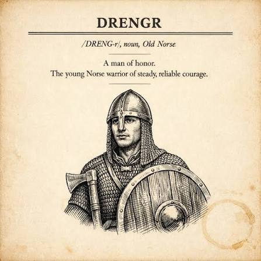

  

# KODE15 — en AI-first bedrift, bygget som kode

Dette er historien om hvordan et lite norsk selskap drifter hele sin
infrastruktur — brannmur, DNS, nettsider, tilgangskontroll — med
AI-agenter som gjør jobben og ett menneske som godkjenner den.

Vi kaller hver tjeneste en **drengr** — norrønt for den unge krigeren med
stø, pålitelig tapperhet. Hos oss er en drengr tre ting som alltid hører
sammen:

1. **Ett repo** — all konfigurasjon og kode, versjonert, ingenting utenfor.
2. **Én container** — tjenesten slik den faktisk kjører, bygget fra repoet.
3. **Én AI-agent** — som bygger, drifter, feilsøker og dokumenterer drengen.

## Mennesket har siste ordet — alltid

Ingen drengr endrer noe viktig på egen hånd. Flyten er alltid den samme:

> Agenten forfatter et **forslag** og committer det i git →
> endringen vises som leselig diff i drengens eget web-UI →
> et **menneske trykker Ja** (godkjenningen bindes til git-commiten) →
> først da utføres endringen — med backup tatt først, og resultatet
> ført tilbake i historikken.

Brannmurregler, DNS-poster, tilgangslister — alt går gjennom denne flyten.
Git-historikken *er* revisjonsloggen: hvem foreslo, hvem godkjente, hva
ble kjørt, hva var backupen.

## Se det live

Dette er ikke et konsept — det er produksjonen vår:

- **[kode15.app](https://kode15.app)** — flåten vår, live: hver drengr med
  status og sertifikater, generert automatisk hvert 10. minutt.
- **[fortigate.kode15.app](https://fortigate.kode15.app)** — se
  brannmurforvaltningen vår i lesemodus: åpne forslag, godkjennings-
  historikk og tilgangsregisteret. Ja, brannmuren vår har en offentlig
  leseside. Sikkerheten ligger i kryptografi og godkjenningsflyt — ikke i
  hemmelighold av hvordan ting virker.

## Hvorfor dele dette?

Fordi «AI-first» for oss ikke betyr en chatbot på kundesiden — det betyr
at selve bedriften er bygget slik at agenter kan arbeide trygt i den:
alt er kode, alt er versjonert, alt krever menneskelig godkjenning der
det gjelder. Dette repoet er startsiden for den fortellingen, og
[kode15.app](https://kode15.app) er der den fortelles.

---

*Startsiden i `web/` er under bygging — den blir selv en drengr i flåten
den beskriver.*
