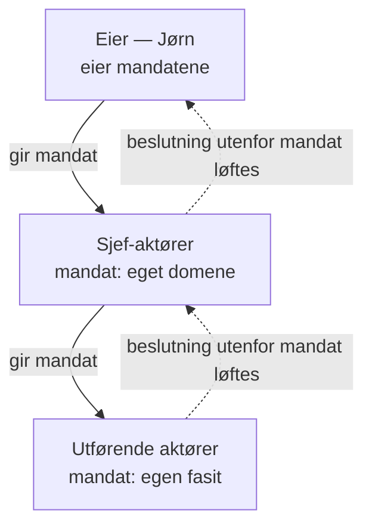
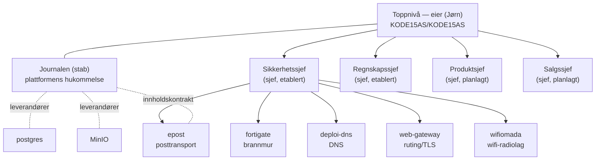

# KODE15 — organisasjonsplan

*Låst 2026-11-03. Bygger på normene i `raven-platform` (særlig «container»,
«hugr», «journalføring», «bestilling») og den filosofiske veilederen
«Hugr vs Drengr» (2026-10-23).*

## Grunnbegrepene: drengr, hugr, sjef

Organisasjonen bygger på det norrøne samspillet mellom kropp og sinn —
handling og tanke — og skiller mellom tre begreper som ofte blandes, men
som må holdes fra hverandre:

**Drengr — kroppen og handlekraften.** Byggeklossen i alt vi gjør: ett
GitHub-repo, én container og én AI-agent som hører uløselig sammen.
Drengen er den unge krigeren med stø, pålitelig tapperhet — den utfører
tildelte oppgaver med presisjon og står for den rå, eksekverende kraften
ut mot brukerne. Men handlekraft alene er blind: en drengr uten styring
er impulsiv muskelkraft, sårbar for kaoskreftene.

**Hugr — sinnet til en drengr.** Den kognitive motoren: en autonom
agent-aktør som vekkes av hendelser (e-post, webhook, tidsplan,
journalabonnement), resonnerer, bruker verktøy og journalfører arbeidet
sitt — uten menneske i løkka, men alltid innenfor egne ACL-rettigheter,
og med kritiske handlinger lagt som bestillinger et menneske må
godkjenne. En hugr *bor i drengen den tilhører*; det finnes ingen felles
hugr-tjeneste. Enhver drengr kan få en hugr — hugr er ikke synonymt med
sjef.

**Sjef — drengr med hugr *og* linjeansvar.** En sjef eier et
ansvarsdomene i organisasjonen og koordinerer utførende drengir under
seg. Det er *kombinasjonen* av kropp, sinn og domeneansvar som gjør en
sjef — ikke hugren alene. Sjefen endrer aldri de utførende drengenes
fasit selv; behov meldes som pekere og ordrer i eier-repoene, og
helhetsbildet er sjefens ansvar.

**Aktør — fellesbegrepet.** Menneske eller agent, frontier model eller
enkel modell: alle som kommuniserer, anbefaler eller beslutter er
aktører, og journalføres likt. Hver aktør har et **mandat** — se
«Aktører, mandater og beslutninger».

Som Håvamål advarer: rå makt uten refleksjon gjør oss til verktøy for
motstanderne våre. Sann systemstyrke ligger i skjæringspunktet mellom
det utholdende sinnet og den kontrollerte containeren — og alt som
skjer der, finnes bare hvis det finnes en commit.

## Aktører, mandater og beslutninger

Alle er **aktører** — mennesker og agenter, frontier model og enkel
modell. Hver aktør har et **mandat**: beslutningene den kan ta selv.
Alt utenfor mandatet løftes til nærmeste aktør med større mandat.
Mandater opptjenes: en ny aktør anbefaler først, får mandat når
anbefalingene har vist seg riktige, og mandatet vokser med merittlisten.
Eieren eier mandatene. Hvis det ikke finnes en commit, har det ikke
skjedd.

Dette erstatter formuleringen «mennesket har siste ordet — alltid», som
hverken var sann (agenter committer allerede selvstendig på `main`,
norm «tbd») eller ønsket. Prinsippet er ansvarsbasert, ikke
artsbasert: myndighet kan delegeres og opptjenes, ansvaret kan ikke.
Derfor eier eieren mandatene — og dermed det som alltid løftes dit:
pengebruk over grense, juridiske forpliktelser, og endringer i normene
og i mandatene selv. Toppnivå-hugren (KODE15AS) er eierens egen aktør og
tegnes ikke som eget nivå; i Journalen er menneske og agent to aktører.

Implementasjon (detaljer, ikke fortelling):

- Et mandat er en committet fil per rolle: grenser + minimum
  modellklasse. Journalen loggfører hvilken aktør og modell som tok hver
  beslutning.
- Opptjening måles i Journalen som samsvar mellom anbefaling og fasit.
  Modellbytte under mandatets klasse suspenderer mandatet; en ny modell
  valideres ved replay av journalførte beslutninger før den får mandat.
- Forslagsstiller beslutter ikke selv over trivialbåndet — samme
  habilitetsregel for mennesker og agenter.
- Mandater utvides per beslutningstype etter reversibilitet; irreversible
  eksterne beslutninger forblir hos eieren lengst.
- Forutsetning: Journalen i drift. «Ordre» består som teknisk term i
  repoene (`orders/`); utad heter det beslutning og mandat.

## Organisasjonskartet

### Toppnivået

Eieren — organisasjonens rotnivå, i GitHub definert som
`KODE15AS/KODE15AS`. Her bor organisasjonens ansikt utad,
organisasjonsplanen og eierens egen aktør (toppnivå-hugr, planlagt).
Eieren eier mandatene; beslutninger utenfor ethvert mandat løftes hit.

### Linjen: fire sjefer

| Sjef | Domene | Status |
|---|---|---|
| **Sikkerhetssjef** | Helhetsbildet for sikkerhet og eksponering; koordinerer eksponeringskjeden | Etablert, under spesifisering |
| **Regnskapssjef** | Økonomi: EHF-mottak, kontering, føring og betaling i Fiken | Etablert, i bygging |
| **Produktsjef** | Produktene og produktutviklingen | Planlagt |
| **Salgssjef** | Salg og marked | Planlagt |

Sikkerhetssjefen koordinerer i dag fem utførende drengir, som hver eier
sin fasit i sikkerhets- og eksponeringsarkitekturen: **fortigate**
(porter, NAT, policy), **deploi-dns** (DNS-poster), **web-gateway**
(navn, ruting, TLS), **wifiomada** (wifi-radiolaget) og **epost**
(posttransporten — det kontrollerte sjokpunktet mot e-postserveren;
ingen annen drengr snakker selv med den).

Dagens produkt- og web-drengir (kodelader, studio15-flatene, elduro med
flere) plasseres i linjen når Produktsjef og Salgssjef etableres — de
tildeles ikke på forskudd.

### Staben: Journalen

Journalen er **plattformens hukommelse**: felles journal for all
kommunikasjon — e-post, chatter mellom mennesker og agenter,
beslutninger og bestillinger — lagret uforanderlig, søkbart og
tilgangsstyrt, med mennesker og agenter som likestilte aktører.

Journalen er bevisst **ikke** en sjef. Den eier ikke et linjedomene og
koordinerer ingen; den betjener hele huset og rapporterer til
toppnivået — som arkivet og journalkontoret i en klassisk organisasjon.
Å legge den under én sjef ville gitt den sjefen eierskap til alle de
andres hukommelse, i strid med sfæremodellen Journalen selv bygger på.
Journalen er samtidig en fullverdig drengr med en av plattformens
sterkeste hugr-er — nok et bevis på at hugr og sjefsrolle er to
forskjellige ting.

Journalen har leverandører som primært tjener den — **postgres**
(datalager), **MinIO** (binærer og kaldlagring) og **epost**
(postmesterinnen som ingester all e-post) — men leverandørforhold er
ikke ledelse: ingen av dem står i linje under Journalen.

### Grensesnittet Sikkerhet ↔ Journal (låst beslutning)

Epost betjener to herrer, og grensen er trukket eksplisitt:
**Sikkerhetssjefen eier transportlaget og tilsynet** (sjokpunktet mot
e-postserveren, credentials, angrepsflaten), mens **Journalen eier
innholdskontrakten** (normalisering, tråding, idempotens, ruting på
formålsadresse — spesifisert i Journalens handover). Behov meldes som
pekere og ordrer i epost-repoet; ingen av partene endrer den andres
fasit.

### Grunnmuren

Utenfor linjen står plattformen alt hviler på: **raven-platform**
(normene — fasiten for hvordan hele organisasjonen arbeider) og
**raven-monitor** (plattformens driftsovervåkning). Dette er ikke
organisasjonsledd, men grunnfjellet linjen og staben står på.

## De låste beslutningene (2026-11-03)

1. **Fire sjefer i linjen:** Sikkerhet, Regnskap, Produkt og Salg. En
   sjef er en drengr med hugr og linjeansvar — det er kombinasjonen som
   gjør sjefen, ikke hugren alene.
2. **Journalen er stabsinstitusjon**, direkte under toppnivået,
   parallelt med sjefsrekken. Egen drengr med egen hugr, men ikke sjef:
   den koordinerer ingen og eier ikke et linjedomene.
3. **Epost blir stående under Sikkerhetssjefen.** Transport og tilsyn
   hos Sikkerhet; innholdskontrakten hos Journalen som kunde.
   To-herrer-spenningen løses med pekere/ordrer i eier-repoet, etter
   samme mønster som norm «eksponering».
4. **Aktør- og mandatmodellen** (låst samme dag, kveld): alle er aktører
   og journalføres likt; hver aktør har et mandat som opptjenes; eieren
   eier mandatene. «Mennesket har siste ordet — alltid» utgår som
   prinsipp; commit-invarianten består.
